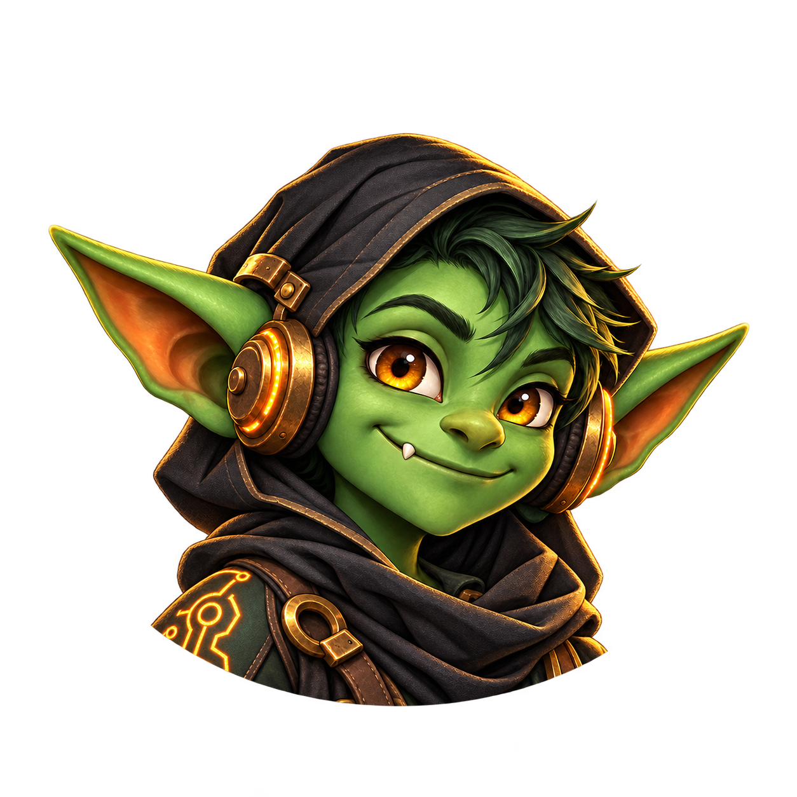

<div align="center">
  

  # Mobile Goblin

  **Your Hermes Agent, from your phone.**

  [](https://github.com/Sharkelot/Mobile-goblin/actions/workflows/apk.yml)
  [](MOBILE_GOBLIN.md)
  [](LICENSE)
</div>

Mobile Goblin is a native Android companion for a running [Hermes Agent](https://github.com/NousResearch/hermes-agent) dashboard. It connects to the same gateway you use on your desktop, so your chats, sessions and approvals follow you to your phone. It has its own package name (`com.sharkelot.mobilegoblin`) and installs beside Kyllene.

## Get the APK

1. Open the [Android APK workflow](https://github.com/Sharkelot/Mobile-goblin/actions/workflows/apk.yml) and select the newest successful run.
2. Under **Artifacts**, download **mobile-goblin-apk**. Unzip it to get `androidApp-debug.apk`.
3. Open the APK on your Android phone and follow its install prompts. Android 8.0 or newer is required.
4. In Mobile Goblin, enter your Hermes dashboard address, test the connection and sign in. The phone must be able to reach your gateway over your local network, Tailscale or HTTPS.

The APK is a debug-signed build. Keep installing APKs from this workflow to update it. A production release will need a persistent release signing key. See [setup and build details](MOBILE_GOBLIN.md).

## What it does

| | |
|---|---|
| **Chat** | Stream replies, inspect reasoning and tool activity, send files and photos, dictate or use voice chat. |
| **Stay in control** | Answer approvals and questions, view background work, and receive reply notifications. |
| **Pick up on mobile** | Open the same gateway sessions as your desktop. Switch profiles, models and chats without copying conversation history. |
| **Use phone features** | Enable optional phone tools and permissions from Settings when you want Hermes to use them. |
| **Keep working offline** | Read the app's cached recent chats when the gateway is temporarily unreachable. |

Mobile Goblin talks to the **Hermes gateway**, not directly to a desktop window. Keep `hermes dashboard` running and reachable from the phone. Sign-in happens on your gateway; do not put credentials in this repository.

## Privacy

Your sign-in and offline chat cache are encrypted with a key held in the Android Keystore, and app data is excluded from backups. There are no analytics or tracking services. Core chat traffic goes to your Hermes gateway.

Optional features may make other connections: update checks query GitHub; tapped images and enabled link previews fetch public web content; remote push notifications use ntfy when you install and enable its gateway plugin. Phone tools start off. If you enable one, data it reads goes to the gateway agent in the chat that requested it. Health Connect data is read only after you grant access; Mobile Goblin does not write health data.

## Goblin art

| Mascot | Android launcher art |
|:---:|:---:|
|  |  |

These are the original Mobile Goblin images. The Android launcher, icon choices and watch app use the goblin artwork; themed icons and notifications use a simple goblin silhouette. Small in-app avatars use a matching vector mark.

## Build

The project uses Kotlin Multiplatform and Jetpack Compose. With a JDK 25 and Android SDK API 37.1 installed, run:

```sh
./gradlew :androidApp:assembleDebug
```

The output is `androidApp/build/outputs/apk/debug/androidApp-debug.apk`. GitHub Actions builds and uploads the same APK on each push to `main`.

## Upstream and license

Mobile Goblin is based on [Kyllene](https://github.com/Giton22/kyllene), which provides the Hermes gateway client and Android feature foundation. The original project is MIT licensed; its license and attribution remain in [LICENSE](LICENSE). Mobile Goblin's branding and goblin artwork are specific to this fork. Hermes Agent is a Nous Research project; Mobile Goblin is an independent companion app.
